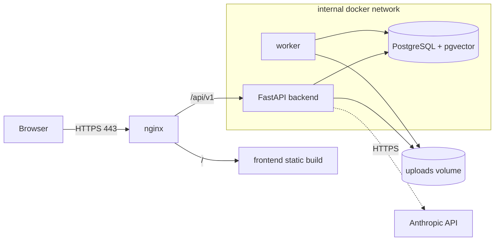

# ProcuraX AI — Architecture

## Context
Greenfield repo. Host: macOS, Docker 29, Node 20, pnpm. Host Python is 3.14, so the backend is
developed and tested **inside a Python 3.12 container** (wheel availability for scikit-learn / psycopg / torch).

## System diagram

Only nginx publishes ports (80/443). Postgres is never published.

## Layers (backend)
`routes (thin)` → `services (business logic)` → `repositories (data access)` → `models (SQLAlchemy 2)`.
Chatbots live in `app/chatbot/<type>/` and call **services**, never raw SQL, so all six share the same data.

## Chatbots
| Type | Mechanism | LLM? |
|---|---|---|
| Rule-based | YAML/DB rules, regex/keyword match, DB-backed values | No |
| NLP | Preprocess + synonyms + TF-IDF/cosine intent baseline behind `IntentClassifier` interface, entity extraction | No |
| ML | scikit-learn: message classifier (TF-IDF+LogReg), stockout risk (GradientBoosting); versioned joblib + `ml_model_registry` | No |
| Generative | `LLMProvider` interface (Anthropic adapter), DB context injected, history | Yes |
| RAG | Local sentence-transformers embeddings → pgvector cosine search → grounded prompt → citations | Yes |
| Agentic | Planner (LLM) → validated tool registry → approval gate → persisted execution steps | Yes |

If no API key: LLM bots return an explicit "provider not configured" response. Rule/NLP/ML work regardless.

## Agent safety
- Tools are a closed registry with Pydantic arg schemas; no SQL/shell tools.
- Each tool declares `required_permission` and `sensitive: bool`. Sensitive tools never run inline: they create an `agent_approvals` row and pause the execution until a human approves.
- Max iterations and wall-clock timeout per execution.

## Security
JWT (access token), argon2/bcrypt hashing, RBAC (Administrator, Procurement Manager, Buyer, Viewer) via permission checks on routes, upload size/type validation, slowapi rate limiting, CORS allow-list, audit log, secrets only via env.

## Key defaults / assumptions
- Embeddings: `sentence-transformers/all-MiniLM-L6-v2`, 384 dims (configurable; dimension recorded per chunk in metadata, column fixed at migration time).
- LLM: Anthropic by default, swap via `AI_PROVIDER` env + `ai_provider_configurations`.
- Worker: a lightweight Postgres-backed job poller (`document_processing_jobs`), no Redis/Celery.
- Single organization seeded (multi-tenant column `organization_id` present for future use).
- All seeded data is **synthetic demo data** and flagged as such in the UI.

## Available stock formula
`available = on_hand - reserved`; `projected = available + on_order`;
`days_of_cover = available / avg_daily_demand`; low-stock when `available <= reorder_level`.
Suggested reorder qty = `ceil(avg_daily_demand * (lead_time_days + review_days) + safety_stock - projected)`, floored at 0.
